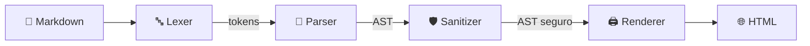

<div align="center">

# 🔨 MarkForge

### Convertí Markdown en HTML **seguro** — sin dependencias, sin XSS, con la seguridad como diseño

[](https://github.com/estebanghinamo/Conversor-md--html/actions/workflows/ci.yml)
[](https://github.com/estebanghinamo/Conversor-md--html/actions/workflows/security.yml)
[](https://sonarcloud.io/dashboard?id=estebanghinamo_Conversor-md--html)


</div>

---

## 🧭 ¿Qué es?

**MarkForge** es una biblioteca y una herramienta de línea de comandos en **Python** que transforma un subconjunto controlado de **Markdown** en **HTML seguro**.

Lo construí como un ejercicio de **ingeniería de software de punta a punta**: no es solo "un conversor", es un proyecto donde cada decisión (arquitectura, seguridad, testing, CI) está pensada, documentada y verificada.

> 💡 **El problema que resuelve:** si una aplicación convierte Markdown escrito por usuarios en HTML sin cuidado, queda expuesta a **XSS** (inyección de scripts), enlaces `javascript:`, y entradas diseñadas para colgar el servidor. MarkForge trata **todo input como hostil** y lo neutraliza por diseño.

---

## ✨ Demo

```markdown
# Hola **mundo**

- uno
- dos con `codigo`

> una cita con [link](https://example.com)
```

```html
<h1>Hola <strong>mundo</strong></h1>
<ul>
<li>uno</li>
<li>dos con <code>codigo</code></li>
</ul>
<blockquote>
<p>una cita con <a href="https://example.com" rel="noopener noreferrer">link</a></p>
</blockquote>
```

### 🛡️ Y con un ataque

```markdown
[clic aqui](javascript:alert) <script>alert('xss')</script> 
```

```html
<p>clic aqui &lt;script&gt;alert(&#x27;xss&#x27;)&lt;/script&gt; x</p>
```

El enlace `javascript:` queda como texto, la imagen `data:` se reemplaza por su texto alternativo, y el `<script>` se escapa. **Nada ejecutable llega a la salida.**

---

## 🏗️ Arquitectura

Un **pipeline** de etapas pequeñas, cada una con una sola responsabilidad:



| Etapa | Archivo | Responsabilidad | Lo que **no** hace |
|---|---|---|---|
| 🔤 **Lexer** | `lexer.py` | Reconoce estructura de bloque línea por línea y emite tokens | HTML, interpretar inline |
| 🧩 **Parser** | `parser.py`, `inline.py` | Agrupa tokens en bloques y resuelve énfasis, código, links e imágenes | HTML, decidir seguridad |
| 🌳 **AST** | `ast.py` | Nodos tipados e **inmutables** (`frozen` dataclasses) | Validar contenido |
| 🛡️ **Sanitizer** | `sanitizer.py` | **Única** capa que decide qué es seguro: valida URLs, normaliza texto | Parsear o escapar HTML |
| 🖨️ **Renderer** | `renderer.py` | Convierte el AST en HTML y **escapa todo, una sola vez** | Interpretar Markdown |
| ⌨️ **CLI** | `cli.py` | Solo entrada/salida (archivo, stdin, `--output`, códigos de salida) | Lógica de conversión |

🔑 **Idea central:** la seguridad vive en un solo lugar (el sanitizer) y el escape en otro (el renderer). Separarlos evita decisiones de seguridad repartidas y el temido *doble escape*. Está registrado en [ADR-003](docs/adr/003-html-sanitization.md).

---

## 🔐 Seguridad por diseño

- ✅ **Lista blanca de esquemas** de URL: solo `http`, `https`, `mailto` y URLs relativas. Todo lo demás (`javascript:`, `data:`, `vbscript:`, `file:`…) se bloquea, incluso con mayúsculas, caracteres de control, espacios Unicode o entidades.
- ✅ **Escape único y total** de `& < > " '` en texto, código, atributos y nombres de clase.
- ✅ **Sin HTML crudo:** el HTML escrito por el usuario se escapa como texto.
- ✅ **Sin dependencias en runtime:** cero superficie de ataque por *supply chain*.
- ✅ **AST inmutable:** el sanitizer devuelve un árbol nuevo; nunca muta el original.
- ✅ **Defensa en profundidad:** el renderer también rechaza nodos desconocidos y árboles demasiado profundos.

### 🧱 Límites anti-DoS

El input es no confiable, así que todo lo que podría crecer sin control tiene un tope:

| 🎯 Qué se limita | 📏 Tope |
|---|---|
| Tamaño total del input | 2.000.000 caracteres |
| Largo de una línea | 100.000 caracteres |
| Cantidad de líneas | 200.000 |
| Citas anidadas | 8 niveles |
| Profundidad del inline | 32 niveles |
| Delimitadores `*` / `~~` por texto | 2.000 |
| Corchetes abiertos | 1.000 |
| Largo de una URL | 2.048 caracteres |

El escaneo es **lineal** (pilas y búsquedas acotadas, sin regex anidadas): sin ReDoS ni tiempos cuadráticos. Detalle completo en [`docs/security.md`](docs/security.md).

### 🐛 Fallos reales que encontraron las revisiones (y que están corregidos)

| 🔍 Hallazgo | 🧯 Cómo se detectó | ✅ Arreglo |
|---|---|---|
| DoS de **tiempo cuadrático** en el parser inline (22 s con 46 KB) | Auditoría de seguridad | Tope + degradación a texto literal → **0,08 s** |
| `--output` sobrescribía el archivo de entrada vía **hard link** | Auditoría de la CLI con PoC | Detección con `samefile` |
| `IndexError` con un carácter de control en el *info string* de un bloque de código | **Property-based testing** (Hypothesis) | Separación explícita por espacio/tab |
| Caracteres **bidi** literales en el código fuente | Semgrep + Sonar en el CI | Armados con `chr()` en tiempo de ejecución |

---

## 🧪 Calidad y testing

| 📊 Métrica | Valor |
|---|---|
| ✅ Tests | **624** (406 unitarios · 96 de integración · 122 de propiedades) |
| 📈 Cobertura (líneas y ramas) | **100 %** (umbral exigido: 90 %) |
| 🧾 Código fuente | ~1.250 líneas |
| 🧪 Código de tests | ~2.760 líneas (más del doble que el código) |
| 🔬 Tipado | `mypy --strict`, sin `Any` |

**Estrategia en capas:**

- 🔹 **Unitarios** — cada etapa aislada, la CLI y la API pública.
- 🔹 **Golden tests** — pares `.md` → `.html` revisados a mano, incluidos casos de ataque XSS.
- 🔹 **Integración end-to-end** — decenas de *payloads* XSS reales recorren todo el pipeline.
- 🔹 **Property-based testing con Hypothesis** — miles de entradas generadas verifican invariantes: `convert` nunca falla de forma inesperada, el HTML solo usa tags y atributos de una lista cerrada, el escape ocurre exactamente una vez, el resultado es determinista y el sanitizer es idempotente.
- 🔹 **Pruebas de mutación manuales** — rompí el código a propósito (quitar un escape, permitir cualquier esquema, borrar un límite) para comprobar que los tests lo detectan. Decenas de mutaciones probadas: las propiedades finales las detectan, y las que sobrevivían al principio dieron lugar a propiedades más fuertes.

Más detalle en [`docs/testing.md`](docs/testing.md).

---

## 🧰 Stack y herramientas

| 🗂️ Área | 🛠️ Herramientas |
|---|---|
| 🐍 **Lenguaje** | Python 3.12+ (solo biblioteca estándar en runtime) |
| 📦 **Gestión de proyecto** | [uv](https://docs.astral.sh/uv/) (lockfile versionado), Hatchling |
| 🎨 **Lint y formato** | [Ruff](https://docs.astral.sh/ruff/) (reglas `E F I B UP S SIM C4 RUF`) |
| 🔬 **Tipado estático** | mypy en modo `strict` |
| 🧪 **Testing** | pytest, pytest-cov (con ramas), **Hypothesis** |
| 🪝 **Hooks locales** | pre-commit (Ruff, detección de claves privadas, archivos grandes) |
| ⚙️ **CI/CD** | GitHub Actions (calidad y seguridad como workflows separados) |
| 📊 **Calidad de código** | SonarCloud con **Quality Gate bloqueante** |
| 🛡️ **Seguridad (SAST)** | CodeQL · Semgrep |
| 🔑 **Secretos** | Gitleaks |
| 📦 **Dependencias** | pip-audit · Dependency Review · Dependabot (uv y Actions) |
| 👥 **Gobierno del repo** | CODEOWNERS, plantillas de PR e issues |
| 📝 **Documentación** | ADRs (registros de decisiones), especificación técnica |

---

## 🧠 Decisiones de ingeniería (ADRs)

Cada decisión importante está registrada con contexto, alternativas y consecuencias:

| 📘 ADR | Decisión |
|---|---|
| [ADR-001](docs/adr/001-parser-architecture.md) | El lexer trabaja por líneas de bloque; el inline vive en el parser y se resuelve con una pila, sin regex anidadas |
| [ADR-002](docs/adr/002-ast-design.md) | AST con dataclasses inmutables y uniones de tipos, en vez de jerarquías con visitor |
| [ADR-003](docs/adr/003-html-sanitization.md) | Sanitizer con lista blanca; el renderer escapa al imprimir (una sola vez) |

Toda la especificación del producto está en [`ESPECIFICACION_DEL_SISTEMA.md`](ESPECIFICACION_DEL_SISTEMA.md).

---

## 🚀 Uso

### ⌨️ Línea de comandos

```bash
markforge input.md                      # HTML por stdout
markforge input.md --output out.html    # HTML a un archivo
markforge input.md --standalone -o out.html   # página completa con estilos (--title para el título)
cat input.md | markforge                # lee de stdin ("-" también)
markforge --help                        # ayuda y códigos de salida
```

| 🚦 Código | Significado |
|---|---|
| `0` | ✅ Éxito |
| `1` | ❌ Input inválido (error de MarkForge, UTF-8 inválido o demasiado grande) |
| `2` | 💥 Error de E/S o de uso (archivo inexistente, salida igual a la entrada…) |

La CLI además **lee el input con tope de memoria**, **no escribe nada si la conversión falla**, **rechaza que la salida sea el mismo archivo que la entrada** (también vía symlinks o hard links) y **nunca imprime el contenido del input en los errores**.

### 📚 Como biblioteca

```python
from markforge import convert

html = convert("# Hola **mundo**")
# '<h1>Hola <strong>mundo</strong></h1>\n'
```

`convert()` recorre el pipeline completo y lanza una subclase de `MarkdownError` (`LexerError`, `ParserError`…) si el input excede los límites.

### 📝 Markdown soportado

Encabezados · párrafos · listas ordenadas y no ordenadas · citas · reglas horizontales · bloques de código con *fences* · tablas simples con alineación · **énfasis** · **negrita** · ~~tachado~~ · `código inline` · enlaces · imágenes · escapes con `\`.

> ℹ️ Es un **subconjunto deliberado** de Markdown, no todo CommonMark. HTML crudo, listas anidadas, tablas complejas y enlaces con título quedan fuera de alcance por diseño. Las líneas que son solo etiquetas HTML (`<div align="center">`, `</div>`) se descartan; cualquier otro HTML se escapa como texto.

---

## 🛠️ Desarrollo

Requiere Python 3.12+ y [uv](https://docs.astral.sh/uv/).

```bash
uv sync                                     # crea el entorno desde uv.lock
uv run pytest --cov                         # tests con cobertura
uv run pytest tests/property                # tests de propiedades (Hypothesis)
uv run pytest tests/property --hypothesis-profile=deep   # búsqueda profunda (5.000 ejemplos)
uv run ruff format . && uv run ruff check . # formato y lint
uv run mypy                                 # tipado estricto
uv run pip-audit                            # vulnerabilidades en dependencias
```

### 🗺️ Estructura del repositorio

```
📦 markforge
├── 📂 src/markforge/
│   ├── lexer.py        # texto → tokens de bloque
│   ├── parser.py       # tokens → AST (bloques)
│   ├── inline.py       # texto → nodos inline (pila, sin regex anidadas)
│   ├── ast.py          # nodos tipados e inmutables
│   ├── sanitizer.py    # única capa que decide seguridad
│   ├── renderer.py     # AST seguro → HTML (escape único)
│   ├── cli.py          # solo E/S
│   └── errors.py       # jerarquía de excepciones
├── 📂 tests/
│   ├── unit/ · integration/ · property/
│   └── fixtures/       # golden tests (.md ↔ .html)
├── 📂 docs/
│   ├── adr/            # decisiones de arquitectura
│   ├── security.md     # política y límites de seguridad
│   └── testing.md      # estrategia de testing
└── 📂 .github/         # workflows de CI y seguridad, Dependabot, CODEOWNERS
```

---

## 🗓️ Roadmap

- [x] Pipeline completo (Lexer → Parser → AST → Sanitizer → Renderer)
- [x] CLI y API pública `convert()`
- [x] Tests unitarios, de integración, *golden* y de propiedades
- [x] CI con Quality Gate, SAST, secretos y auditoría de dependencias
- [ ] 🧬 Mutation testing automatizado (`mutmut`, meta ≥ 80 %)
- [ ] 🌀 Fuzzing con Atheris
- [ ] 🐳 Imagen Docker (usuario no-root, Hadolint, Trivy)
- [ ] 📋 SBOM (CycloneDX)

---

## 🎯 Qué demuestra este proyecto

- 🏛️ **Diseño de software:** arquitectura en pipeline, separación de responsabilidades, decisiones documentadas en ADRs.
- 🔒 **Mentalidad de seguridad:** modelado de amenazas, defensa en profundidad, límites anti-DoS y revisiones de seguridad que encontraron y corrigieron fallos reales.
- 🧪 **Cultura de testing:** del test unitario al *property-based testing*, pasando por pruebas de mutación manuales para validar que los tests realmente detectan fallos.
- ⚙️ **Ingeniería de plataforma:** CI/CD con calidad y seguridad automatizadas, análisis estático, gestión de dependencias y gobierno del repositorio.
- 📐 **Rigor:** tipado estricto, 100 % de cobertura, cero dependencias en runtime y documentación al día.

---

## 📄 Licencia

Distribuido bajo licencia **MIT**. Ver [`LICENSE`](LICENSE).

<div align="center">

Hecho con 🧠 y mucho ☕ por [**@estebanghinamo**](https://github.com/estebanghinamo)

</div>
