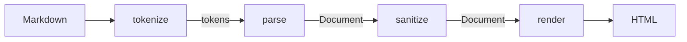

# Arquitectura de MarkForge

MarkForge es una biblioteca y una CLI que convierten un subconjunto de Markdown en HTML seguro. No hay backend web, base de datos ni dependencias en runtime. Este documento explica cómo encajan las piezas; el porqué de cada decisión está en los [ADR](adr/) y la política de seguridad en [security.md](security.md).

## Flujo de datos

`convert()` en `markforge/__init__.py` es exactamente esa composición: `render(sanitize(parse(tokenize(markdown))))`. La CLI y `--standalone` se apoyan en ella sin tocar el pipeline.

| Etapa | Entrada → salida | Garantiza |
|---|---|---|
| `lexer.tokenize` | `str` → `list[Token]` | Escaneo lineal y topes de tamaño. No interpreta inline. |
| `parser.parse` | `list[Token]` → `Document` | Estructura de bloques e inline resueltos con pila y topes. |
| `sanitizer.sanitize` | `Document` → `Document` | Único punto que decide qué es seguro. Devuelve un árbol nuevo. |
| `renderer.render` | `Document` → `str` | Escapa todo texto y atributo al imprimir, una sola vez. |

## Reglas que se mantienen

1. **Cada etapa tiene una responsabilidad.** El lexer no conoce el renderer; el parser no genera HTML; el renderer no parsea ni decide seguridad.
2. **La seguridad vive solo en el sanitizer** y el escape solo en el renderer ([ADR-003](adr/003-html-sanitization.md)). Repartirlos produce decisiones duplicadas y el doble escape.
3. **Los datos son crudos y no confiables hasta salir del sanitizer.** El AST del parser lleva URLs y texto sin validar.
4. **El AST es inmutable** ([ADR-002](adr/002-ast-design.md)): son `dataclass(frozen=True)` y las etapas devuelven estructuras nuevas, nunca mutan las recibidas.
5. **Cada etapa acota sus recursos.** Los topes (tamaño, anidación, delimitadores, tablas) están en [security.md](security.md); al excederlos se lanza el error de la etapa o el texto queda literal.

## Decisiones de diseño relevantes

- **El lexer solo ve bloques; el inline vive en el parser** ([ADR-001](adr/001-parser-architecture.md)). El lexer emite un token por línea (más un token por bloque de código y uno por tabla) y `inline.py` resuelve énfasis, código, links e imágenes con una pila, sin regex anidadas.
- **Las citas se reprocesan:** el parser quita el marcador `>` y vuelve a llamar al lexer sobre el contenido. Por eso `MAX_NESTING_DEPTH` acota tanto la recursión como el pico de memoria.
- **Tablas simples y descarte de líneas solo-etiquetas HTML** ([ADR-005](adr/005-tables-and-html-tags.md)): un token `TABLE` multilínea con alineación; el HTML restante siempre se escapa como texto.
- **E/S solo en la CLI** ([ADR-004](adr/004-cli-io-policy.md)): `cli.py` lee, escribe y traduce errores a códigos de salida (0 éxito, 1 input inválido, 2 error de E/S o de uso). `page.py` solo envuelve el HTML ya renderizado con estilos y un CSP.

## Modelo de errores

Todas las excepciones derivan de `MarkdownError` (`errors.py`): `LexerError`, `ParserError`, `SanitizationError` y `RenderError`. Quien use `convert()` puede capturar la base. Los topes del inline no lanzan error: lo que excede queda como texto literal.

## Cómo extender

Agregar sintaxis nueva implica recorrer el pipeline en orden y dejar cada responsabilidad en su etapa:

1. Token o regla en el lexer, o solo en el inline si no es de bloque.
2. Nodo nuevo en `ast.py` y su construcción en el parser.
3. Reglas de seguridad del nodo en el sanitizer (¿lleva URLs, atributos, texto?) y su salida en el renderer, con escape.
4. Tests en cada capa, un golden test y, si toca seguridad, un caso en los tests XSS y una línea en [security.md](security.md). Si cambia una decisión estructural, una ADR nueva.

La guía práctica está en [contributing.md](contributing.md).
